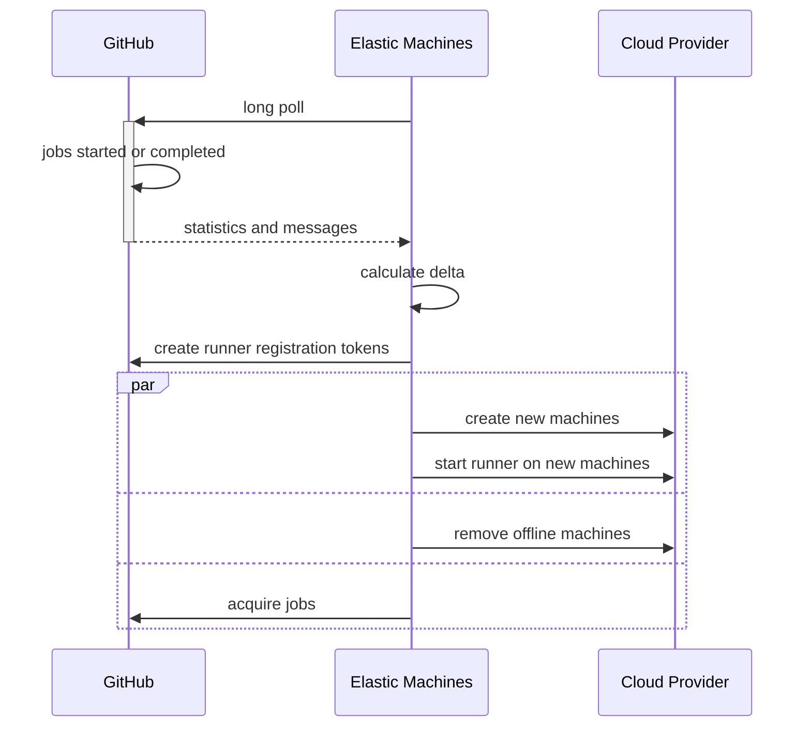
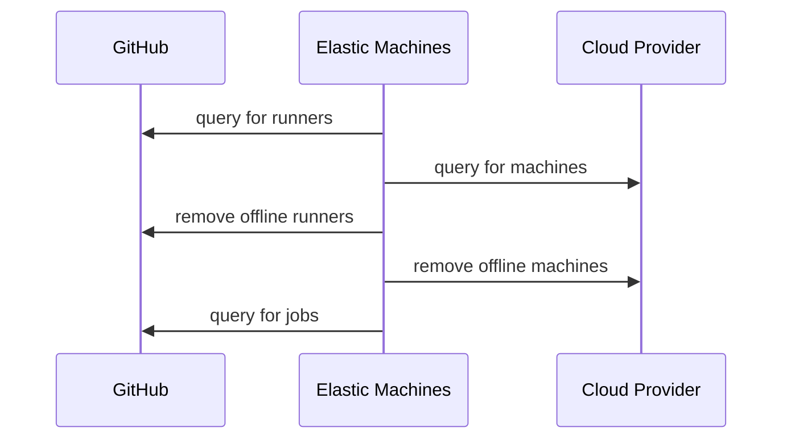
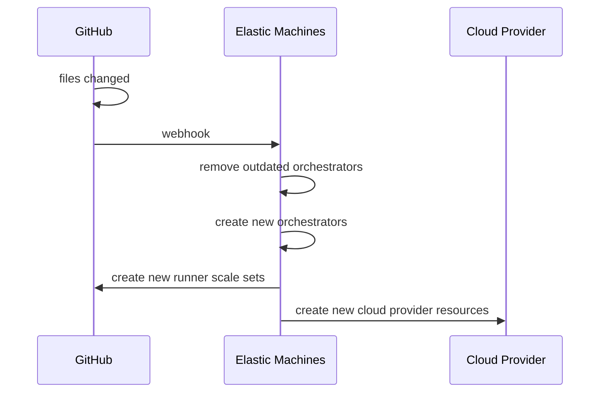
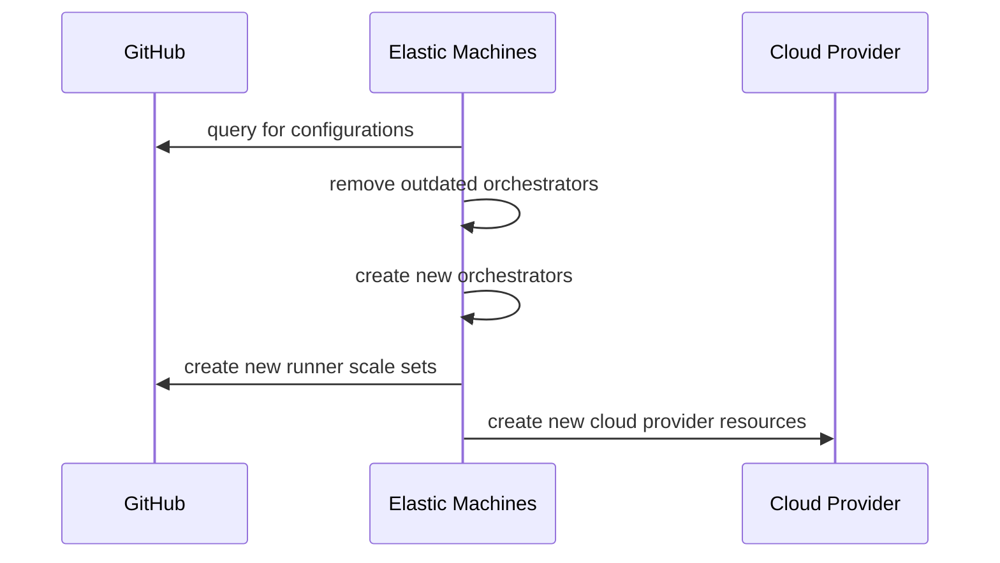

# Design

Understanding how Elastic Machines communicates with GitHub and cloud providers can help you understand Elastic Machines's behavior and troubleshoot any issues. This overview is fairly high level since Elastic Machines is actively developed and details will change over time.

## Communication

Elastic Machines's main function is to facilitate communication between GitHub and various clouds (AWS, Azure, etc.). Elastic Machines gathers data about the state of jobs and runners in GitHub and instructs the cloud provider to create or destroy machines to match the desired capacity.

### Long poll

Elastic Machines uses long polling to get data from GitHub as quickly as possible. Every poll triggers the following sequence.

### Refresh state

Elastic Machines also does a full refresh every hour to detect discrepancies.

## Configuration updates

Elastic Machines has a separate process to keep track of `elastic-machines.yml` files in your repositories and apply updates when changes are detected.

### Webhooks

Webhooks are optional, but enabling `push` events allows Elastic Machines to detect configuration changes immediately.

### Refresh configurations

Elastic Machines also does a full refresh every hour to detect discrepancies.

